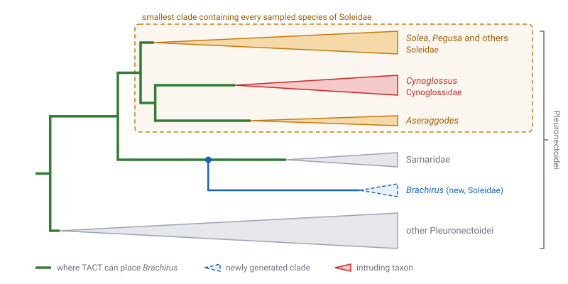
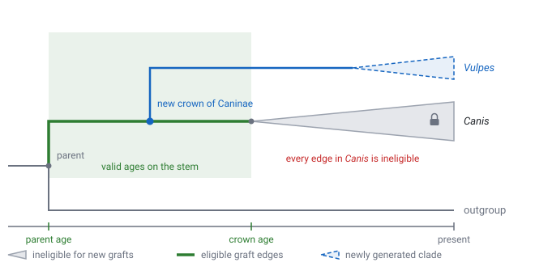

# Troubleshooting TACT

This guide helps you diagnose and fix common problems when using TACT. If you're new to TACT, you might want to start with the [Tutorial](tutorial.md) or [Background](background.md) first.

## Initial Steps

If something isn't working:

1. Make sure you've [installed the latest version of TACT](install.md) and it's working:
   ```sh
   tact_add_taxa --version
   ```

2. Use `-vv` (two v's) to see debugging messages as TACT runs:
   ```sh
   tact_add_taxa --backbone yourtree.tre --taxonomy yourtaxonomy.tre --output result -vv
   ```

3. Look at `{output}.log.txt` for detailed information about what TACT is doing and any warnings or errors.

The verbose output and log files will often flag issues around monophyly or other problems that TACT might be struggling with.

## Why is TACT breaking up my monophyletic clades?

 TACT tries to preserve monophyly when placing unsampled species, but sometimes it appears to "break up" groups that should stay together.

There are two things to check:

1. **Is the clade defined in the taxonomy file?** If the clade isn't defined in your taxonomy file, TACT won't know to preserve it as a monophyletic group.

2. **Is the clade actually monophyletic in your backbone tree?** A clade is monophyletic if all species in that group share a single common ancestor, and that ancestor has no other descendants outside the group. 

!!! example

    If you have a clade M with species A, B, and C, and their most recent common ancestor is node X, the clade M is monophyletic only if node X has exactly three descendants: A, B, and C (and no others).

If you have a single "rogue" species that breaks up an otherwise monophyletic clade, TACT will mark all edges of that clade as valid placement points for unsampled taxa. This can cause a mostly nice-looking group to turn into a complete mess.

For example, in the [tutorial](tutorial.md) dataset, the smallest clade that contains every sampled species of Soleidae also contains _Cynoglossus_, from the family Cynoglossidae. Soleidae is therefore not monophyletic in the backbone, so TACT searches for the next eligible ranked node, which is Pleuronectoidei. This means that a group like genus _Brachirus_ in Soleidae, which has no sampled species, can be placed anywhere in the suborder Pleuronectoidei, not only among other soles.



To find these taxa, look at the summary `tact_add_taxa` prints when it finishes, or at `{output}.placements.csv`: the `intruders` column names the backbone tips that break up each affected taxon (see [the placement report](commands.md#tact_add_taxa)).

Two solutions are possible here:

1. Drop the rogue taxon (using e.g., `ape::drop.tip` in R) and let TACT place it somewhere more appropriate, or
2. Expand the definition of your clade in the taxonomy file to include the rogue taxon.

## How long will TACT take?

These timings come from an Apple M1 laptop (8 cores, 16 GB) with [hyperfine](https://github.com/sharkdp/hyperfine), using CPython 3.15. Carangaria is the [tutorial](tutorial.md) dataset (1,057 species, 642 added); Percomorphaceae is the largest example (17,301 species, 10,438 added) from `examples/setup_percomorphaceae.py`.

`tact_add_taxa` (mean wall time in seconds ± standard deviation; Carangaria over 5 runs, Percomorphaceae over 3):

| Python | Carangaria | Percomorphaceae |
|:---|---:|---:|
| CPython 3.15 | 1.88 ± 0.14 | 53.4 ± 3.8 |
| CPython 3.15 with the experimental JIT (`PYTHON_JIT=1`) | 2.00 ± 0.22 | 51.0 ± 0.3 |
| CPython 3.15, in the Docker image | 2.63 ± 0.64 | 60.6 ± 1.9 |

CPython's JIT makes no consistent difference, so use the standard Python interpreter. On a Mac, Docker runs TACT in a Linux virtual machine, which makes large datasets take about 15% longer, and starting the container adds about a second, more on a busy machine.

To repeat these measurements, run `benchmark.py` from a checkout of TACT.

!!! note "Earlier versions and PyPy"
    Earlier versions of TACT were much slower on large datasets, and these instructions recommended [PyPy](https://www.pypy.org/) to make up for it. TACT 0.8.0 took 479 seconds on Percomorphaceae with CPython 3.14, and 337 seconds with its Docker image, which used PyPy 3.11. Modern versions of TACT are much faster, so we now recommend a standard Python install for simplicity.

## What is crown capture probability?

**Crown capture probability** is the probability that when you sample `k` species from a clade containing `n` total species, your sample includes the crown node (the most recent common ancestor of all living species in that clade). This is calculated under a Yule (pure-birth) model of diversification. See [Sanderson (1996)](https://doi.org/10.1093/sysbio/45.2.168) for the full mathematical description.


In the figure above, the crown is captured when the sampled species include at least one from each of the two clades that descend from it (a). Otherwise, the crown of the sampled tree is younger than the true crown, and some of the unsampled species actually branch off its stem (b). TACT cannot tell which of these happened, so it uses the probability of (a) to decide how much to trust the sampled crown.

This probability is used in two key places in TACT as a cutoff, and can be tweaked using the `--min-ccp` parameter to `tact_add_taxa`.

First, TACT will refuse to estimate diversification rates for taxa where the crown capture probability falls below the cutoff. For example, if the known diversity of a genus is 10 species, but the backbone tree only has 3 species, the probability that you've successfully sampled the crown node is approximately 61%. TACT will instead use the next oldest taxonomy node, such as a family or tribe (if defined), to estimate the diversification rate for this group.

Second, TACT will permit stem placement of unsampled taxa if the crown capture probability of the sampled taxon falls below the cutoff. For example, if the known diversity of a genus is 10 species, but the backbone tree only has 3 species, TACT will consider the stem of the group a valid graft point for the remaining 7 species.

The default cutoff of 0.8 was chosen since it balanced between being relatively loose with respect to stem placements, while still giving reasonable results. You can disable this feature altogether by setting it either to 0, meaning the crown is always assumed to be sampled, or to 1, meaning the crown is assumed to be sampled only for taxa with every species in the backbone. The latter will tend to produce odd results and is not recommended.

## Taxon has a minimum age constraint A but oldest generated time was B < A

This message appears when TACT is generating an entire monophyletic clade from scratch (e.g., you have a genus that is completely unsampled), but the only valid place to graft this new clade based on the stem age of the clade is incompatible with valid attachment points in the phylogeny.

Suppose you have a family with three genera: _Canis_ (n=5), _Lycalopex_ (n=6), and _Vulpes_ (n=11). If _Canis_ is completely unsampled, and _Lycalopex_ and _Vulpes_ are well-sampled and reciprocally monophyletic, the only valid placement for the stem of _Canis_ would be on the stem of _Lycalopex_, the stem of _Vulpes_, or (potentially) the stem of the entire canine subfamily. All the more recent (tipwards) graft points are part of these monophyletic groups and are therefore not considered ("locked") when attaching this new clade.

The minimum age A is the age of the youngest "unlocked" edge. If the attachment time B drawn for _Canis_ is younger than A, the only edges alive at that time are locked inside _Lycalopex_ and _Vulpes_, so there is nowhere to attach it.


TACT will generate a single new divergence time with a minimum age constraint to replace the original stem age. This could lead to very short internal branches, or unusual placements of new clades.

## Taxon is fully locked, so attaching to stem

This message appears when TACT is generating an entire monophyletic clade from scratch (e.g. you have a genus that is completely unsampled), but the only valid place to graft this new clade is inside another clade.

Suppose you have a family Caninae with two genera, _Canis_ and _Vulpes_, but you've only sampled species from _Canis_. TACT will generate the entire _Vulpes_ clade from scratch, and attempt to attach it somewhere within Caninae, but all the edges subtending the crown node of that group are already part of _Canis_, and TACT will refuse to break the monophyly of that group.



TACT will generate a single new divergence time constrained so that it will attach somewhere on the stem of the sampled clade. This could lead to very short internal branches, or unusual placements of new clades.

## N short branches detected

This message can appear in the log after TACT adds species to a clade. It counts the branches in that clade that are 0.001 time units long or shorter, which is 1,000 years if your tree is in millions of years. The count covers the whole clade, so branches counted for a genus can be counted again for its family.

This is not an error, and there isn't necessarily anything wrong. A young clade with many species has to fit many speciation events into a short time, so some of its branches will be very short, in the real tree as well as in TACT's. If a downstream program has trouble with very short branches, look at which clades they are in before changing anything.

## Warnings from `tact_check_results`

[`tact_check_results`](commands.md#tact_check_results) compares each taxon in the taxonomy between the backbone and the tree from `tact_add_taxa`, and writes one row per taxon. The `warnings` column is empty for a taxon that passed.

A taxon that is not monophyletic in the backbone (`backbone_monophyletic` is `False`) is not a warning by itself. TACT places the species of such taxa in a higher taxon instead, as described [above](#why-is-tact-breaking-up-my-monophyletic-clades), and reports them when it finishes.

**BACKBONE and SIMULATED trees differ in monophyly for this taxa:** the taxon is monophyletic in the backbone, but not in the tree from `tact_add_taxa`. TACT never places species inside the clade of a monophyletic taxon unless they belong to it, so this should not happen. First, check that you gave `tact_check_results` the same backbone and taxonomy that you gave `tact_add_taxa`. If you did, please [report it](https://github.com/jonchang/tact/issues) with your input files and the `--seed` you used.

## Tips are not in the taxonomy

Every tip in the backbone must be a species in the taxonomy. Spaces, underscores and case do not matter, so `Gobius_niger` in the backbone matches `Gobius niger` in the taxonomy. TACT lists the backbone tips it could not find. Either add these species to the taxonomy, or, if they are outgroups that should not be part of it, name them with `--outgroups`, separated by commas.

## Names spelled more than one way

TACT treats names that differ only in spaces, underscores or case as the same name. Within one file, two such spellings are an error if they are tips of a tree (such as `Gobius_niger` and `'Gobius niger'`), internal taxa of a taxonomy tree, or species in a taxonomy CSV, because TACT cannot tell which one is meant. Spell each the same way throughout. Rank names in a taxonomy CSV are instead read as one taxon, with a note listing the spellings.

## This is a Nexus file

The backbone must be a Newick tree. To convert a single tree in R, run `ape::write.tree(ape::read.nexus("tree.nex"), "tree.tre")`.

## Branches have no length

The backbone needs branch lengths in units of time. A tree without any branch lengths is usually a topology rather than a dated tree.

## Tree is not ultrametric

TACT requires ultrametric trees because it uses time-based calculations to place unsampled species. The error names the tips closest to and farthest from the root, with their distances, and how many tips are closer to the root than the farthest one. If only a few tips are closer, they may be extinct or wrongly dated; if almost every tip is, the tree probably has rounding errors throughout.

TACT tests for ultrametricity before running. If your tree falls outside a certain precision threshold (by default, 1e-6, or roughly six digits after the decimal point), TACT will refuse to run. This is mostly intended as a safety check to ensure that you haven't accidentally passed a [phylogram](https://en.wikipedia.org/wiki/Phylogram) (a tree with branch lengths in units of change, not time) or a phylogeny with extinct tips to TACT.

If your tree is mostly ultrametric but has minor rounding errors, TACT will automatically adjust the ages slightly to make everything line up. This won't really affect your results. For more details on checking and fixing ultrametric trees, see this [blog post](https://jonathanchang.org/blog/three-ways-to-check-and-fix-ultrametric-phylogenies/).

## Tree is not binary

TACT requires binary trees as input. The error lists each node that does not have exactly two branches below it, with the number of branches and a tip from each, so that you can find it in the tree. A node with one branch below it usually comes from extra parentheses in the Newick file.

This error sometimes occurs when you have a basal trifurcation (three branches at the root) in your phylogeny, which often represents an unrooted tree. You'll need to root your tree before using it with TACT. TACT will generally assume that a basal trifurcation represents a rooted tree, but this doesn't always work correctly, so it's better to root your tree explicitly using an outgroup or other method before running TACT.

!!! tip "Next steps"
    Ready to use TACT? Check out the [tutorial](tutorial.md) to continue learning about TACT, or refer to the [command reference](commands.md) to customize your analysis.
